# **1. Instalación máquina virtual**
La instalación de la máquina virtual de Ubuntu la realizaremos con VirtualBox. Lo primero que haremos será descargar la ISO desde la página oficial de Ubuntu.

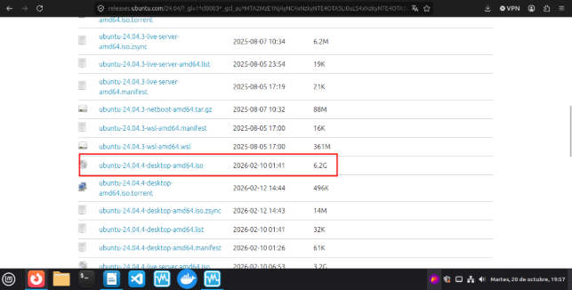

Después de instalar la ISO, crearemos una nueva máquina virtual con las siguientes características:

- Nombre: Ubuntu-DAW2DAW.
- RAM: 4096 MB
- Disco duro virtual: mínimo 50 GB
- Tipo de red: NAT

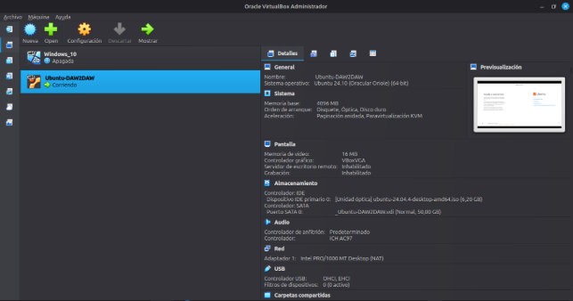

Una vez que hemos terminado de instalar y configurar la máquina, lo que haremos será instalar las Guest Additions

Para ello en VirtualBox, iremos a la pestaña dispositivos de la barra de opciones y haremos clic en la opción de insertar imagen de CD de los complementos del invitado.

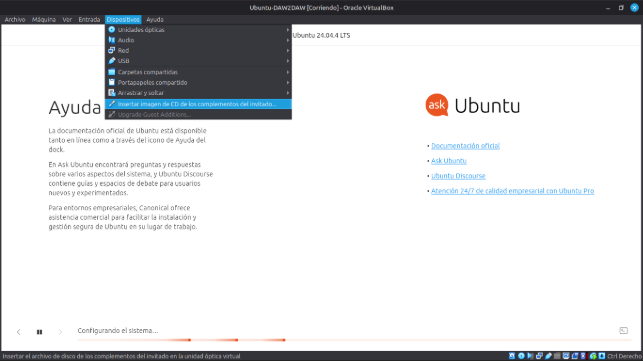 

Una vez que se ha insertado el CD correctamente, lo que haremos será abrir la carpeta desde la terminal.

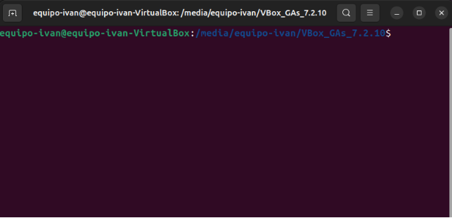

Una vez dentro del terminal ejecutaremos el siguiente comando: sudo ./VBoxLinuxAdditions.run

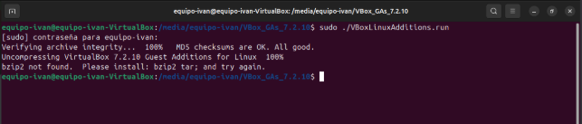

*Como podemos ver, el comando nos da un error debido a que nos falta por instalar el paquete bzip2*

Para poder instalarlo tendremos que ejecutar el siguiente comando: sudo apt install bzip2

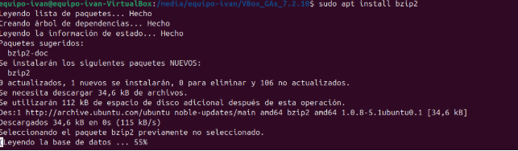

Una vez instalado, ejecutaremos el comando que nos ha dado error anteriormente (sudo ./VboxLinuxAdditions.run)

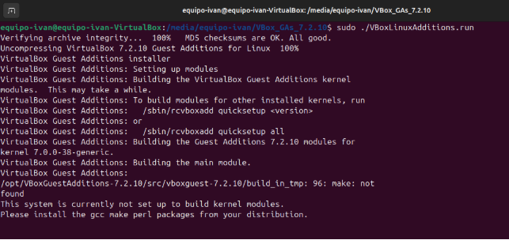

Después de haberlo instalado, reiniciaremos la máquina virtual y ya veremos que la pantalla se ajustará correctamente

https://tecnosender.com/instalar-guest-additions-en-ubuntu-24-04-virtualbox/
# **2. Instalación Docker Desktop**
Para poder instalar Docker Desktop en nuestra máquina Ubuntu tendremos que ejecutar una serie de comandos para instalarlo. Estos comandos son los siguientes:

- Actualizar los repositorios:
  - sudo apt update && sudo apt upgrade -y

    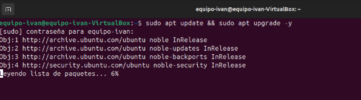

- Instalar dependencias:
  - sudo apt install ca-certificates curl gnupg -y

    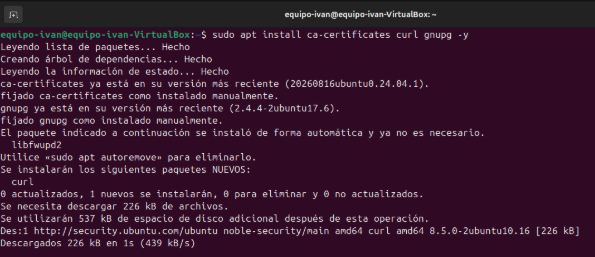

- Añadir el repositorio de Docker e instalar Docker Desktop
  - curl -fsSl [https://get.docker.com](https://get.docker.com/) -o get-docker.sh y sudo sh get-docker.sh

    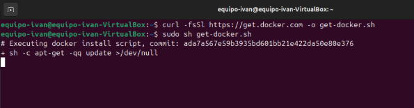

- Verificar que Docker funciona correctamente
  - docker --version y docker run hello-world

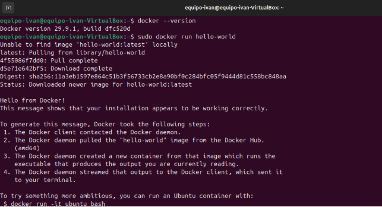	
# **3. Instalación de contenedores web y de aplicaciones**
En nuestra máquina instalaremos los siguientes contenedores:

- Servidor web: Atiende peticiones HTTP/HTTPS (ej: Nginx, Apache)
- Servidor de aplicaciones: Ejecuta la lógica de negocio (ej: Tomcat, WildFly)

Para ello lo que haremos será instalar desde Docker los contenedores necesarios. Esto lo haremos con los siguientes comandos.

- Buscar imágenes disponibles:
  - docker search nginx y docker search tomcat

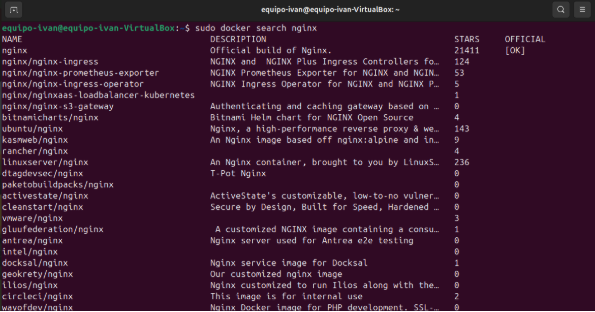

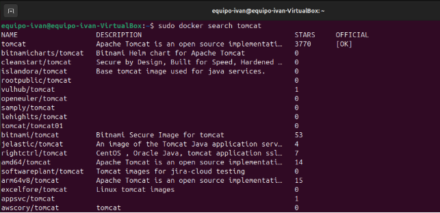	

- Descargar e iniciar contenedores:
  - docker run -d -p 8080:80 --name webserver nginx

    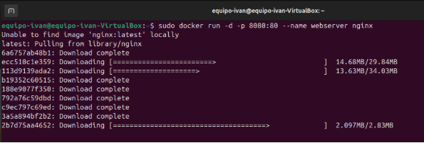

  - docker run -d -p 8081:8080 --name appserver tomcat

    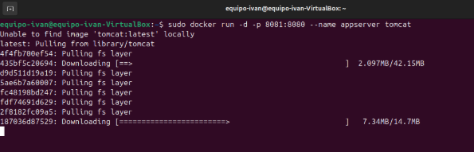

- Verificar contenedores activos:
  - sudo docker ps

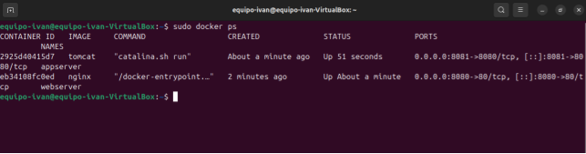

Una vez que los hemos instalado, abriremos en el navegador las siguientes URLs para poder comprobar que se han instalado correctamente:

- [http://localhost:8080](http://localhost:8080/) → Nginx

  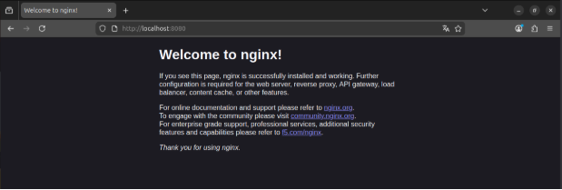

- 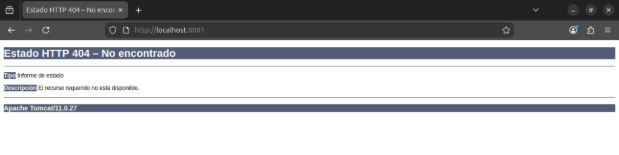[http://localhost:8081](http://localhost:8081/) → Tomcat
