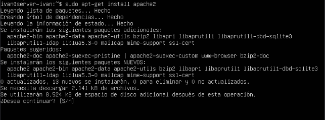
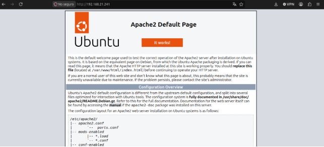
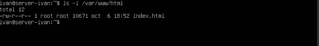
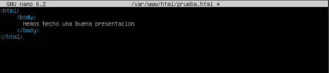
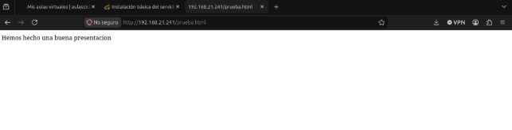

**Índice**

[Modelos de arquitectura web	2](#__refheading___toc1_891410988)

[Modelo punto a punto	2](#__refheading___toc8_891410988)

[Modelo cliente-servidor	2](#__refheading___toc10_891410988)

[Modelo con servidor de aplicaciones	3](#__refheading___toc16_891410988)

[Modelo con servidor de aplicaciones externo	3](#__refheading___toc18_891410988)

[Modelo con varios servidores de aplicaciones	4](#__refheading___toc20_891410988)

[Instalación básica del servidor web Apache en Ubuntu Server	5](#__refheading___toc5_891410988)

# **Modelos de arquitectura web**
## **Modelo punto a punto**
**Ventajas:** 

- Cuanto más nodos haya conectados, mejor será el funcionamiento del servidor. 
- Los clientes pueden localizar los recursos sin depender del correcto funcionamiento de un único servidor.
- Ningún nodo es imprescindible para el funcionamiento de la red.
- No se hace la carga sobre un único nodo de la red.

**Desventajas:** 

- No hay garantía de que los recursos obtenidos desde un nodo sean realmente los deseados.
- La actualización de los recursos compartidos debe realizarse en todos los nodos.

<https://javiergarciaescobedo.es/despliegue-de-aplicaciones-web/76-arquitecturas-web/253-modelos-de-arquitecturas-web>
## **Modelo cliente-servidor**
**Ventajas**

- Los accesos, recursos y la integridad de los datos son controlados por el servidor de forma que un programa cliente defectuoso o no autorizado pueda dañar el sistema, facilitando así la tarea de actualizar datos u otros recursos.
- Se puede aumentar la capacidad de clientes y servidores por separado y en cualquier momento. 
- Al estar distribuidas las funciones y responsabilidades entre varios ordenadores, se puede reemplazar, reparar, actualizar o trasladar un servidor y los clientes no se verían afectados por los cambios. Esto se conoce como ***encapsulación*.**

**Desventajas**

- Cuando una gran cantidad de clientes envían peticiones simultaneas al mismo servidor, puede ser que cause muchos problemas para éste (a mayor número de clientes, más problemas para el servidor)
- Cuando un servidor está caído, las peticiones de los clientes no pueden ser satisfechas.
- El software y el hardware de un servidor son generalmente muy determinantes. Un hardware regular de un ordenador personal puede no poder servir a cierta cantidad de clientes. Normalmente se necesita software y hardware específico, sobre todo en el lado del servidor, para satisfacer el trabajo. Por supuesto, esto aumentará el coste.
- El cliente no dispone de los recursos que pueda existir en el servidor.

<https://javiergarciaescobedo.es/despliegue-de-aplicaciones-web/76-arquitecturas-web/253-modelos-de-arquitecturas-web>

## **Modelo con servidor de aplicaciones**
**Ventajas**

- Oculta la base de datos del usuario y filtra las solicitudes maliciosas.
- Procesa la lógica pesada en el servidor, lo que permite usar clientes más ligeros y sencillos.
- Facilita actualizar reglas de negocio o corregir errores en un solo lugar sin modificar el dispositivo cliente.
- Permite ampliar recursos o añadir más servidores de apoyo.

**Desventajas**

- Requiere hardware potente, licencias y mantenimiento especializado.
- Exige una programación más estricta y conocimientos técnicos avanzados.
- Si el servidor de aplicaciones se cae o sufre retrasos, los usuarios pierden acceso al servicio.

<https://www.ionos.es/digitalguide/servidores/know-how/servidor-de-aplicaciones/>

## **Modelo con servidor de aplicaciones externo**
**Ventajas**

- Podemos ampliar la potencia del servidor de aplicaciones sin modificar el servidor web o la base de datos.
- La lógica de negocio y los datos sensibles quedan ocultos tras el servidor web.
- Al repartir las tareas, el sistema se satura menos
- Facilita actualizar el software o corregir errores en la aplicación sin interrumpir el acceso general a la página web.

**Desventajas**

- La configuración inicial y la red de comunicaciones entre servidores exigen conocimientos avanzados.
- Requiere más recursos de hardware, licencias o infraestructura en la nube.
- Las peticiones tardan un poco más en responder porque deben viajar entre el cliente, el servidor web y el servidor de aplicaciones externo.
- Si falla la red interna o el servidor de aplicaciones externo, toda la plataforma deja de funcionar correctamente.

<https://www.ionos.es/digitalguide/servidores/know-how/servidor-de-aplicaciones/>
##
## **Modelo con varios servidores de aplicaciones**
**Ventajas**

- Si un servidor falla, los demás siguen funcionando y la aplicación no se cae.
- Podemos añadir más servidores fácilmente cuando crece el tráfico de usuarios.
- Al repartir las peticiones, el sistema responde más rápido.
- Podemos actualizar o reparar un servidor mientras los otros atienden al público.

**Desventajas**

- Configurar, sincronizar y administrar varias máquinas requiere conocimientos avanzados.
- Requiere más inversión en hardware, licencias y sistemas de red.
- Mantener la sesión de los usuarios o los datos actualizados en todos los servidores es difícil.
- Si falla el balanceador de carga principal, todo el sistema puede quedar inaccesible.

<https://www.ionos.es/digitalguide/servidores/know-how/servidor-de-aplicaciones/>
# **Instalación básica del servidor web Apache en Ubuntu Server**
Para realizar la instalación del servidor Apache desde Ubuntu Server lo que haremos será ejecutar la siguiente instrucción: sudo apt-get install apache2

Una vez que se ha realizado la instalación correctamente, lo que haremos será comprobar el funcionamiento del servidor web. Para ello, desde otra máquina virtual o desde nuestro cliente (conectada con el servidor web) introduciremos en el navegador la dirección IP de la máquina en la que se ha instalado el servidor web. El resultado debe ser una página similar a la siguiente:

*Esta página que aparece por defecto nos informa de que el servidor está funcionando pero aún no hemos añadido contenido al mismo.*

Los archivos que contienen las páginas web deben almacenarse en la carpeta /var/www/html. En dicha carpeta se encuentra el archivo index.html

*Si modificamos el contenido de este archivo podremos hacer que cambie la página web a la que hemos accedido anteriormente para comprobar el funcionamiento del servidor web.*

Para poder modificar este archivo, debemos tener en cuenta que la carpeta /var/www/html tiene permisos de escritura únicamente para el superusuario root. Para ello, tendremos que utilizar el comando nano con la instancia de superusuario. El comando a utilizar es el siguiente: sudo nano archivo.html

Una vez que hemos añadido el archivo, lo que haremos será desde nuestra máquina real entrar a la página web que hemos creado.

