

**IMPLEMENTACIÓN DEL PROTOCOLO HTTPS Y CERTIFICADOS SSL/TLS EN APACHE2**

Alumno: Iván Guijarro Verbo

Curso: 2º DAW

Asignatura: Despliegue de aplicaciones web

**Índice**

[Investigación teórica	3](#__refheading___toc1_1147307634)

[Funcionamiento del protocolo HTTPS y su importancia	3](#__refheading___toc3_1147307634)

[El proceso TLS Handshake (Apretón de manos TLS)	3](#__refheading___toc5_1147307634)

[Importancia en la seguridad web	3](#__refheading___toc7_1147307634)

[Tipos de certificados SSL/TLS: Autofirma vs CA confiable	4](#__refheading___toc9_1147307634)

[Módulos de Apache2 necesarios	4](#__refheading___toc18_1147307634)

[Ejecución técnica paso a paso	4](#__refheading___toc11_1147307634)

[Instalación y verificación de Apache2	4](#__refheading___toc20_1147307634)

[Habilitación de módulos SSL, Headers y Rewrite	5](#__refheading___toc22_1147307634)

[Generación del certificado SSL/TLS	5](#__refheading___toc24_1147307634)

[Configuración del VirtualHost en el puerto 443	6](#__refheading___toc26_1147307634)

[Redirección automática HTTP → HTTPS	6](#__refheading___toc28_1147307634)

[Valida sintaxis y recargar Apache	6](#__refheading___toc31_1147307634)

[Verificación y evidencias de funcionamiento	7](#__refheading___toc33_1147307634)

[Verificación en consola (curl)	7](#__refheading___toc35_1147307634)

[Comprobación del Handshake SSL/TLS	7](#__refheading___toc37_1147307634)

[Verificación en el navegador web	7](#__refheading___toc39_1147307634)

[Conclusiones y dificultades encontradas	9](#__refheading___toc41_1147307634)

[Conclusiones	9](#__refheading___toc43_1147307634)

[Dificultades encontradas y soluciones	9](#__refheading___toc45_1147307634)

[Bloqueo de puertos en el firewall	9](#__refheading___toc47_1147307634)

[Advertencia de navegador al usar el certificado autofirmado	9](#__refheading___toc49_1147307634)

# **Investigación teórica**
## **Funcionamiento del protocolo HTTPS y su importancia**
HTTPS (HyperText Transfer Protocol Secure) es la extensión segura del protocolo HTTP. Utiliza el protocolo TLS (Transport Layer Security) para garantizar la seguridad de los datos transmitidos entre el navegador cliente y el servidor web.
### **El proceso TLS Handshake (Apretón de manos TLS)**
1. **Client Hello:** El cliente se conecta al servidor (puerto 443) enviando las versiones de TLS soportadas y una lista de algoritmos de cifrado.
1. **Server Hello y certificado:** El servidor responde seleccionando el algoritmo de cifrado y enviando su certificado digital (que contiene su clave pública).
1. **Verificación y clave pre-master:** El cliente verifica la validez del certificado con su lista de Autoridades de Certificación (CA). Si es válido, genera una clave secreta pre-master cifrada con la clave pública del servidor.
1. **Generación de clave simétrica:** Ambos extremos utilizan la clave pre-master para calcular la clave de sesión simétrica.
1. **Comunicación cifrada:** Toda la transferencia posterior de datos (peticiones GET/POST, formularios, cookies) se realiza mediante cifrado simétrico (ej: AES), el cual es rápido y seguro.
   ### **Importancia en la seguridad web**
- **Confidencialidad:** Impide que atacantes intercepten la comunicación (eavesdropping)
- **Integridad:** Asegura que los datos no sean modificados en tránsito mediante código HMAC.
- **Autenticidad:** Confirma la identidad del sitio web, previniendo ataques de phishing y Man-In-The-Middle (MitM).
## **
## **Tipos de certificados SSL/TLS: Autofirma vs CA confiable**

|**Criterio**|**Certificado autofirmado**|**Certificado de CA confiable (Let’s Encrypt)**|
| - | - | - |
|Firma / emisor|Firmado por el propio administrador del servidor|Firmado por una entidad certificadora reconocida mundialmente.|
|Confianza en navegador|Muestra advertencia de seguridad (NET::ERR\_CERT\_AUTHORITY\_INVALID)|Muestra conexión segura automáticamente (candado verde/cerrado)|
|Coste|Gratuito|Gratuito (Let’s Encrypt) o de pago (DigiCert, Sectigo)|
|Uso recomendado|Entornos de desarrollo, pruebas locales o redes internas (LAN)|Entornos de producción, e-commerce y sitios web públicos|

## **Módulos de Apache2 necesarios**
- mod\_ssl (ssl): Proporciona soporte para cifrado fuerte usando los protocolos SSL/TLS y habilita la escucha en el puerto 443.
- mod\_headers (headers): Permite manipular cabeceras HTTP de respuesta, esencial para implementar políticas de seguridad como HSTS (HTTP Strict Transport Security)
- mod\_rewrite (rewrite): Motor de reescritura de reglas que permite redirigir el tráfico del puerto 80 (HTTP) al puerto 443 (HTTPS) de forma transparente.
# **Ejecución técnica paso a paso**
## **Instalación y verificación de Apache2**
Se actualiza el sistema e instala el servidor web Apache2 con el comando sudo apt update && sudo apt install apache2 -y

Después se verifica que el servicio está funcionando con el comando: sudo systemctl status apache2

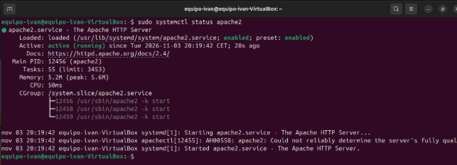
## **Habilitación de módulos SSL, Headers y Rewrite**
Se activan los módulos necesarios en Apache2 y se reinicia el servicio para aplicar los cambios. Esto se hace con los comandos: sudo a2enmod ssl, sudo a2enmod headers, sudo a2enmod rewrite y sudo systemctl restart apache2

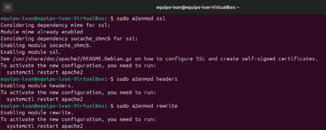
## **Generación del certificado SSL/TLS**
Para este entorno, se genera un certificado autofirmado mediante openssl con el siguiente comando: sudo openssl req -x509 -nodes -days 365 -newkey rsa:2048 -keyout /etc/ssl/private/apache-selfsigned.key -out /etc/ssl/certs/apache-selfsigned.crt

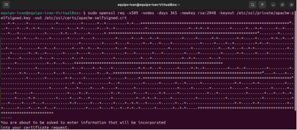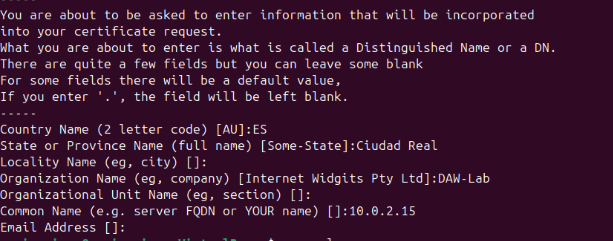
## **Configuración del VirtualHost en el puerto 443**
Cambiaremos el contenido del archivo de configuración que está en la ruta /etc/apache2/sites-available/default-ssl.conf

Después lo habilitaremos en el VirtualHost de SSL con el comando sudo a2ensite default-ssl.conf

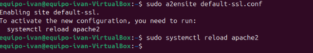
## **Redirección automática HTTP → HTTPS**
Modificaremos el sitio por defecto en el puerto 80 para forzar la navegación. Esto lo haremos editando el archivo que está en la ruta /etc/apache2/sites-available/000-default.conf

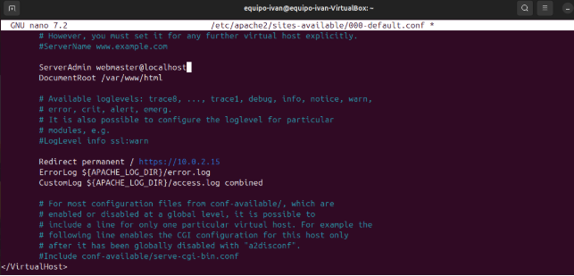
## **Valida sintaxis y recargar Apache**
A continuación se realizará la comprobación de errores de configuración con los siguientes comandos: sudo apachectl configtest y sudo systemctl reload apache2

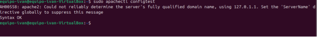
# **
# **Verificación y evidencias de funcionamiento**
## **Verificación en consola (curl)**
Esto se realizará con el comando curl -I [http://localhost]()

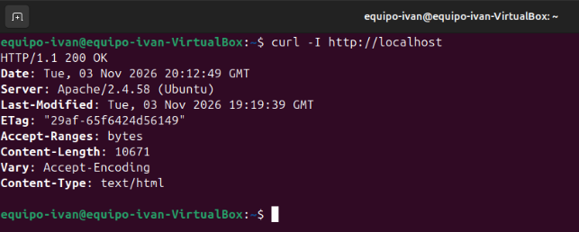
## **Comprobación del Handshake SSL/TLS**
Esto se realizará con el comando curl -kIv [https://localhost]()

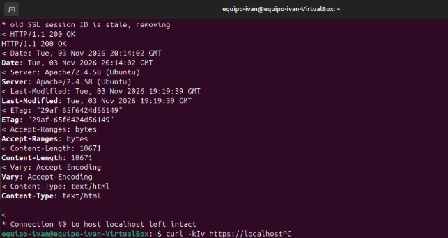
## **Verificación en el navegador web**
Al acceder a [https://DIRECCION_IP](https://DIRECCION_IP/)[, el navegador muestra una advertencia de seguridad esperada al tratarse de un certificado autofirmado]()

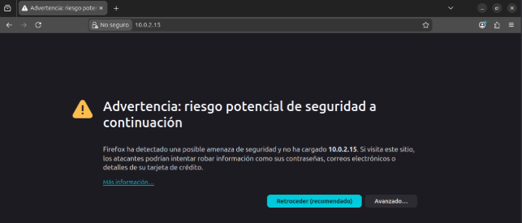

Si hacemos clic en avanzado y a continuar a la página, accederemos al sitio web.

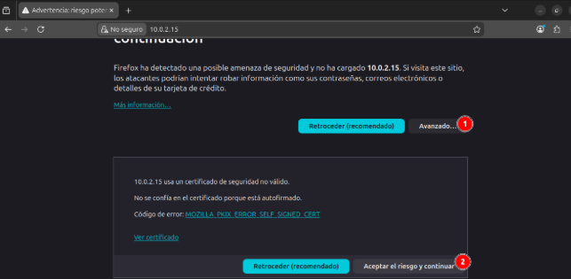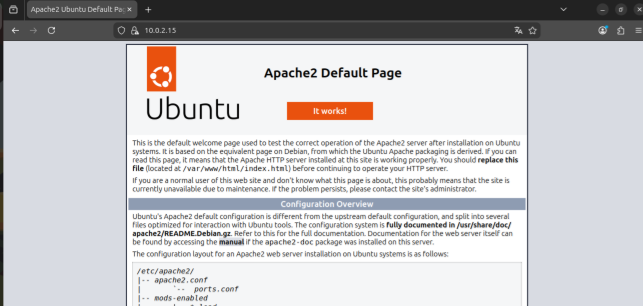
# **Conclusiones y dificultades encontradas**
## **Conclusiones**
1. La implementación exitosa del protocolo HTTPS en Apache2 garantiza la integridad y confidencialidad de las comunicaciones entre el cliente y el servidor.
1. La configuración de redirección en el puerto 80 asegura que ningún usuario navegue sin cifrado, incluso si intenta acceder por HTTP explícitamente.
1. Se ha comprobado la diferencia práctica entre certificados autofirmados (ideales para pruebas de desarrollo) y los de CA pública (necesarios para producción para evitar alertas al usuario)
   ## **Dificultades encontradas y soluciones**
   ### **Bloqueo de puertos en el firewall**
- Dificultad: Al intentar acceder externamente vía HTTPS, la conexión se quedaba colgada.
- Solución: Se permitió el tráfico mediante sudo ufw allow ‘Apache full’
### **Advertencia de navegador al usar el certificado autofirmado**
- Dificultad: El navegador bloqueaba el acceso de forma predeterminada.
- Solución: Se verificó que el comportamiento era el esperado y se añadió la excepción de seguridad en el navegador para completar las pruebas de carga.
