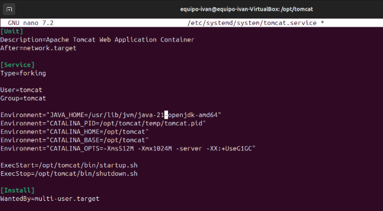
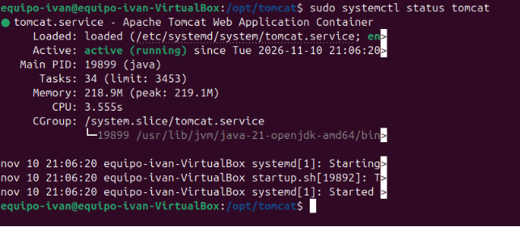
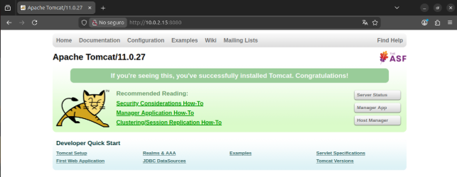

# **1. Actualizar el sistema e instalar Java 17 o 21**
Tomcat 11 no funcionará con versiones antiguas de Java. Instala el kit de desarrollo (JDK) de OpenJDK ejecutando:

```
sudo apt update
```

```
sudo apt install openjdk-21-jdk -y
```

# **2. Crear un usuario dedicado para Tomcat**
Por motivos de seguridad, nunca se debe ejecutar el servidor como root Crea un grupo y un usuario del sistema que no tenga permisos de inicio de sesión directo. Esto lo haremos con los siguientes comandos

```
sudo groupadd tomcat
```

```
sudo useradd -s /bin/false -g tomcat -d /opt/tomcat tomcat
```

# **3. Descargar y extraer Apache Tomcat 11**
Nos moveremos al directorio temporal, descargaremos la versión exacta Apache Tomcat 11.0.27 y la extraeremos en la ruta /opt/tomcat. Esto los haremos con los siguientes comandos: 

cd /tmp

wget [https://apache.org](https://apache.org/)

sudo mkdir -p /opt/tomcat

sudo tar -xzvf apache-tomcat-11.0.27.tar.gz -C /opt/tomcat –strip-components=1

# **4. Configurar los permisos del directorio**
Modificaremos los privilegios para que el usuario tomcat que creamos antes pueda gestionar y ejecutar los archivos. Esto lo haremos con los comandos:

cd /opt/tomcat

sudo chgrp -R tomcat /opt/tomcat

sudo chmod -R g+r conf

sudo chmod g+x conf

sudo chown -R tomcat webapps/ work/ temp/ logs/ 

sudo chmod +x bin/\*.sh 

# **5. Crear el servicio Systemd para Tomcat**
Para gestionar la aplicación como un servicio nativo de Ubuntu, crearemos un archivo de configuración en systemd con el comando:

sudo nano /etc/systemd/system/tomcat.service



# **6. Iniciar y habilitar el servidor**
Recargaremos la configuración del sistema para que detecte el nuevo servicio, lo arrancaremos y configuraremos para que se inicie automáticamente cada vez que se encienda el servidor. Esto lo haremos con los siguientes comandos:

sudo systemctl daemon-reload

sudo systemctl start tomcat 

sudo systemctl enable tomcat 

Verificaremos que esté corriendo sin errores con el comando: 

sudo systemctl status tomcat 
# 
# **7. Comprobación final**
Abriremos el navegador y pondremos la dirección IP de nuestra máquina seguida del puerto predeterminado de Tomcat (8080)
